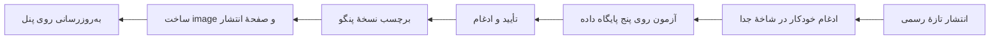

<div dir="rtl">

# پنل پنگو: فورک پاسارگارد

**فارسی** · [English](README.en.md)

<p align="center">
  <a href="https://github.com/Hugsyyyy/pasarguard-panel/releases/latest"></a>
  <a href="https://github.com/Hugsyyyy/pasarguard-panel/actions/workflows/pengu-ci.yml"></a>
  <a href="https://github.com/Hugsyyyy/pasarguard-panel/actions/workflows/test-database-migrations.yml"></a>
  <a href="../LICENSE"></a>
  <a href="https://github.com/PasarGuard/panel"></a>
</p>

## این مخزن چیست

این مخزن **فورک** پنل [PasarGuard](https://github.com/PasarGuard/panel) است و برای سرویس پنگو نگه‌داری می‌شود. خود پنل را تیم پاسارگارد می‌سازد. ما هر نسخهٔ رسمی را برمی‌داریم، چند قابلیت خودمان را رویش می‌گذاریم و همه را دوباره آزمایش می‌کنیم.

- **هر چیزی که در نسخهٔ رسمی هست، این‌جا هم هست:** همان پنل، همان API، همان پایگاه داده‌ها و همان نودها.
- **هر نسخه و هر رفع باگ رسمی** خودکار به این مخزن می‌آید و بعد از گذشتن از آزمون‌ها منتشر می‌شود.
- **تغییرهای ما کوچک و جدا** نگه داشته شده‌اند، تا ادغام نسخه‌های رسمی تمیز بماند.

## چه چیزی اضافه دارد

| | نسخهٔ رسمی | این فورک |
|---|:---:|:---:|
| همهٔ امکانات و رفع باگ‌های رسمی | ✓ | ✓ |
| «هاست‌های من»: نام، ترتیب و نمایش سرورها برای کاربران هر نماینده | ✗ | ✓ |
| روشن و خاموش کردن «هاست‌های من» برای هر نقش | ✗ | ✓ |
| دیدن و پاک کردن تنظیمات «هاست‌های من» هر نماینده توسط مالک | ✗ | ✓ |
| «صفحه‌های اشتراک»: هر ادمین صفحهٔ اشتراک کاربران خودش را از یک گالری با پیش‌نمایش زنده انتخاب می‌کند | ✗ | ✓ |
| نصب قالب‌های شناخته‌شدهٔ صفحهٔ اشتراک با یک دکمه، با نسخه و هش ثابت | ✗ | ✓ |
| ورود تکراری ربات‌ها بدون بررسی دوبارهٔ رمز، با CPU خیلی کمتر | ✗ | ✓ |
| بخش نسخهٔ داشبورد که از انتشارهای همین مخزن خبر می‌دهد | — | ✓ |
| به‌روزرسانی با `pasarguard update` از همین مخزن | — | ✓ |

## هاست‌های من، برای نماینده‌ها

نماینده‌ها در منوی کنار داشبورد صفحه‌ای به اسم **هاست‌های من** دارند. هر تغییری آن‌جا بدهند **فقط روی اشتراک کاربران خودشان** اثر می‌گذارد. هاست‌های اصلی پنل و کاربران بقیهٔ نماینده‌ها دست نمی‌خورند.

**نماینده چه کارهایی می‌تواند بکند:**

- **عوض کردن نام هر سرور** با همان متغیرهای نام هاست؛ مثلاً `🇩🇪 آلمان {USERNAME}`، `{STATUS_EMOJI} {DATA_LEFT}` یا `{DAYS_LEFT} روز`. متغیرهای دیگر: `{DATA_USAGE}`، `{DATA_LIMIT}`، `{TIME_LEFT}`، `{EXPIRE_DATE}` و `{JALALI_EXPIRE_DATE}`.
- **جابه‌جا کردن ترتیب** با کشیدن و رها کردن، یا با دکمه‌های بالا و پایین در موبایل.
- **پنهان کردن سرورهایی** که نمی‌خواهد به کاربرانش برسد؛ کنار تیک هر سرور «نمایش» یا «پنهان» نوشته می‌شود.
- **بازنشانی** نام یک سرور، ترتیب، یا همه‌چیز با یک دکمه.

**چه کسی این صفحه را دارد:**

- ادمین‌هایی که نقششان اجازهٔ ساخت یا ویرایش هاست ندارد و گزینهٔ «استفاده از هاست‌های من» در آن روشن است.
- این گزینه در صفحهٔ «نقش‌های مدیر»، پنجرهٔ «ویرایش نقش»، بخش «قابلیت‌ها» است. برای نقش‌هایی که از قبل بوده‌اند روشن است.
- اگر مالک آن را برای نقشی خاموش کند، صفحه از منوی ادمین‌های آن نقش برداشته می‌شود و تغییرهایشان دیگر به کاربرانشان نمی‌رسد. تغییرها پاک نمی‌شوند و با روشن کردن دوباره برمی‌گردند.
- مالک پنل و ادمین‌هایی که هاست‌ها را ویرایش می‌کنند این صفحه را ندارند؛ برایشان معنایی ندارد.

**قاعده‌ها:**

- هر نماینده فقط سرورهای **گروه‌هایی را می‌بیند که نقشش اجازه دارد**.
- تا نماینده ترتیب را دست نزند، کاربرانش **همان ترتیب پنل** را می‌گیرند. چیدمان تصادفی هم اگر روشن باشد می‌ماند، و تغییرهای بعدی مدیر پنل به آن‌ها می‌رسد.
- اگر نماینده ترتیب خودش را بگذارد، **سرورهایی که بعداً به پنل اضافه می‌شوند ته فهرستش** می‌آیند و در صفحه‌اش دیده می‌شوند تا جابه‌جایشان کند.
- سروری که مدیر پنل غیرفعال کرده، برای کاربران هیچ نماینده‌ای نمایش داده نمی‌شود.
- نام‌ها همان محدودیت‌های نام هاست اصلی را دارند و ورودی نامعتبر رد می‌شود.

**امنیت:**

- کلیدهای API با مجوز سفارشی، حتی کلید خود مالک، به این قابلیت راه ندارند.
- ادمینی که محدود شده نمی‌تواند تغییری ذخیره کند.
- مالک می‌تواند تنظیمات هر نماینده را ببیند و پاک کند (بخش «مسیرهای API» در پایین).

## صفحه‌های اشتراک، برای هر ادمین

هر ادمین در منوی کنار داشبورد بخشی به اسم **صفحه‌های اشتراک** دارد. آن‌جا صفحه‌ای را انتخاب می‌کند که **کاربران خودش** با باز کردن لینک اشتراک در مرورگر می‌بینند. کاربران بقیهٔ ادمین‌ها دست نمی‌خورند و کانفیگی که برنامه‌ها می‌گیرند عوض نمی‌شود.

**در این بخش چه هست:**

- پیش‌نمایش زندهٔ هر صفحه با یک کاربر ساختگی: کوچک روی کارت، و بزرگ در دو حالت موبایل و دسکتاپ.
- صفحهٔ «پیش‌فرض پنل»: همان صفحه‌ای که تا امروز همه می‌دیدند. تا ادمین چیز دیگری انتخاب نکند همین می‌ماند.
- صفحه‌هایی که مالک از فهرست آماده نصب کرده است.
- صفحه‌های دست‌ساز مالک که در پوشهٔ قالب‌ها گذاشته شده‌اند.

**فهرست آماده:**

| صفحه | سازنده | ساخته‌شده برای | از سایت‌های دیگر چه می‌گیرد |
|---|---|---|---|
| PasarGuard | [PasarGuard](https://github.com/PasarGuard/subscription-template) | پاسارگارد | هیچ‌چیز |
| Ourenus | [MatinDehghanian](https://github.com/MatinDehghanian/Ourenus) | پاسارگارد و مرزبان | فونت از Google Fonts؛ لوگو و فهرست دستگاه‌ها از گیت‌هاب سازنده |
| PGClock | [Mrclocks](https://github.com/Mrclocks/PGClock) | پاسارگارد | فونت و اسکریپت کد QR، هر دو با نسخهٔ ثابت |
| PGClock Lite | [Mrclocks](https://github.com/Mrclocks/PGClockLite) | پاسارگارد | فونت و اسکریپت کد QR، هر دو با نسخهٔ ثابت |
| PGClock Plus | [Mrclocks](https://github.com/Mrclocks/PGClockPlus) | پاسارگارد | فونت با نسخهٔ ثابت |
| PGClock Pro | [Mrclocks](https://github.com/Mrclocks/PGClockPRO) | پاسارگارد | فونت با نسخهٔ ثابت |
| PGClock Fusion | [Pasham0](https://github.com/Pasham0/PGClockFusion) | پاسارگارد | فونت و پرچم کشورها با نسخهٔ ثابت |
| Neon | [7Berlin](https://github.com/7Berlin/pasarguard-neon-template) | پاسارگارد | هیچ‌چیز |
| Marzban Sub | [x0sina](https://github.com/x0sina/marzban-sub) | مرزبان | اسکریپت، استایل، آیکون و فونت از چند سایت، بعضی بدون نسخهٔ ثابت |
| Marzban Templates 01 | [MuhammadAshouri](https://github.com/MuhammadAshouri/marzban-templates) | مرزبان | اسکریپت و استایل از چند سایت، بخشی بدون نسخهٔ ثابت از مخزن سازنده |

**نصب چطور کار می‌کند:**

- هیچ‌کدام از این صفحه‌ها همراه پنل نمی‌آیند. مالک «نصب» را می‌زند و پنل همان فایل را از مخزن گیت‌هاب سازنده‌اش دانلود می‌کند.
- نسخهٔ هر صفحه ثابت است و SHA-256 فایل در کد پنل نوشته شده؛ فایلی که حتی یک بایت فرق کند نصب نمی‌شود.
- این هش فقط خود فایل را می‌پوشاند. چیزهایی که صفحه هنگام باز شدن از سایت‌های دیگر می‌گیرد (ستون آخر جدول) بیرون از آن است؛ مالک همین را روی کارت هر صفحه می‌بیند.
- فایل‌ها در پوشهٔ `subscription/pengu-pages` داخل `CUSTOM_TEMPLATES_DIRECTORY` می‌نشینند. اگر این متغیر در `.env` نباشد نصب خاموش است و داشبورد همین را می‌گوید.
- دو صفحهٔ آخر برای مرزبان نوشته شده‌اند. پنل داده‌ها را به شکلی که آن‌ها انتظار دارند می‌دهد تا روی پاسارگارد هم درست کار کنند.
- صفحهٔ خودتان را هم می‌توانید اضافه کنید: فایل را با نام `index.html` در پوشهٔ `subscription/pengu-pages/<name>` بگذارید. نام پوشه فقط حروف کوچک انگلیسی، عدد و خط تیره باشد.

**چه کسی می‌تواند انتخاب کند:**

- هر نقش گزینهٔ «انتخاب صفحهٔ اشتراک» دارد: صفحهٔ «نقش‌های مدیر»، پنجرهٔ «ویرایش نقش»، بخش «قابلیت‌ها». پیش‌فرضش روشن است.
- اگر مالک آن را برای نقشی خاموش کند، این بخش از منوی ادمین‌های آن نقش برداشته می‌شود، ولی صفحه‌ای که الان دارند برای کاربرانشان می‌ماند.
- مالک می‌تواند صفحه‌ای را به یک ادمین بدهد و قفلش کند: مسیر صفحه را از روی کارتش کپی می‌کند و در فیلد «مسیر قالب اشتراک» فرم همان ادمین می‌گذارد.

**امنیت:**

- صفحه‌ها کد دیگران‌اند. پیش‌نمایش هر صفحه در قاب ایزوله اجرا می‌شود و به نشست داشبورد دسترسی ندارد.
- ادمین‌ها فقط از میان صفحه‌های نصب‌شده انتخاب می‌کنند و نمی‌توانند فایلی بفرستند.
- کلیدهای API با مجوز سفارشی به این قابلیت راه ندارند، و ادمینی که محدود شده نمی‌تواند صفحه را عوض کند.
- اگر فایل صفحهٔ انتخابی یک ادمین حذف شود، کاربرانش صفحهٔ پیش‌فرض را می‌بینند و اشتراکشان خراب نمی‌شود.
- با حذف یک صفحه توسط مالک، ادمین‌هایی که آن را داشتند به صفحهٔ پیش‌فرض برمی‌گردند.

## ورود تکراری بدون فشار روی سرور

بعضی ربات‌ها و اپ‌ها قبل از هر درخواست دوباره وارد پنل می‌شوند. هر ورود یک بررسی رمز با bcrypt است که حدود نیم ثانیه CPU می‌گیرد. ربات یکی از نماینده‌های ما با حدود ۲۵۰ ورود در دقیقه، دو هسته از چهار هستهٔ سرور را فقط با همین کار مشغول کرده بود.

در این فورک، رمزی که همین حالا درست بررسی شده تا **۵ دقیقه** به خاطر سپرده می‌شود و ورود دوباره با همان رمز دیگر این CPU را نمی‌گیرد. برای ربات‌ها و نماینده‌ها چیزی عوض نمی‌شود و لازم نیست کاری بکنند.

**آنچه از امنیت حفظ شده:**

- **رمز غلط هیچ‌وقت به خاطر سپرده نمی‌شود** و همیشه کامل بررسی می‌شود. حدس زدن رمز از راه شبکه ارزان‌تر نشده است.
- **با عوض شدن رمز، رمز قبلی همان لحظه از کار می‌افتد.**
- **ادمین غیرفعال یا حذف‌شده** مثل قبل رد می‌شود، حتی اگر ورودش به خاطر سپرده شده باشد.
- **خود رمز ذخیره نمی‌شود.** فقط یک اثبات رمزنگاری‌شده در حافظهٔ پنل می‌ماند که بعد از مهلت پاک می‌شود و با ری‌استارت هم از بین می‌رود.

**آنچه باید بدانید:**

- تا وقتی یک ورود به خاطر سپرده شده، کسی که بتواند حافظهٔ پردازهٔ پنل را بخواند می‌تواند رمز را حدود ۵۰ برابر ارزان‌تر از bcrypt حدس بزند. چنین کسی از قبل کلید امضای توکن و رمز پایگاه داده را هم دارد.
- مهلت با متغیر `PENGU_LOGIN_CACHE_SECONDS` در فایل `.env` عوض می‌شود (پیش‌فرض ۳۰۰ ثانیه، حداکثر ۳۶۰۰). مقدار `0` این قابلیت را خاموش می‌کند. بعد از تغییر، پنل را ری‌استارت کنید.
- جزئیات فنی در [PENGU.md](../PENGU.md) است.

## نصب

این فورک فقط image پنل را در همان نصب رسمی پاسارگارد عوض می‌کند. پایگاه داده، نودها و بقیهٔ سرویس‌ها همان‌اند.

**پنل تازه:**

**۱.** پنل را با [اسکریپت نصب رسمی پاسارگارد](https://github.com/PasarGuard/scripts) نصب کنید.

**۲.** قدم‌های «پنل موجود» را انجام دهید.

**پنل موجود** (که الان نسخهٔ رسمی دارد):

**۱.** پشتیبان بگیرید:

```sh
pasarguard backup
```

**۲.** در فایل `/opt/pasarguard/docker-compose.yml`، در بخش سرویس `pasarguard`، خط image را عوض کنید:

```yaml
image: ghcr.io/hugsyyyy/pasarguard-panel:pengu-latest
```

**۳.** فقط پنل را با image تازه بالا بیاورید. پایگاه داده و بقیهٔ سرویس‌ها دست نمی‌خورند:

```sh
cd /opt/pasarguard
docker compose pull pasarguard
docker compose up -d --no-deps pasarguard
```

مهاجرت‌های پایگاه داده موقع بالا آمدن خودکار اجرا می‌شوند. بعد از آن، نسخهٔ پنل در داشبورد چیزی مثل `5.6.0-pengu.4` است.

> فعلاً image فقط برای سرورهای `amd64` (x86_64) ساخته می‌شود.

## به‌روزرسانی

بعد از نصب، **دستور `pasarguard update` از همین مخزن به‌روز می‌کند**: آخرین انتشار این فورک (`pengu-latest`) را می‌کشد و پنل را ری‌استارت می‌کند. داشبورد هم وقتی انتشار تازه‌ای بیاید خبر می‌دهد.

- دستور `pasarguard update` همهٔ imageهای `docker-compose.yml` را می‌کشد، از جمله پایگاه داده، و همهٔ سرویس‌ها را دوباره بالا می‌آورد؛ مثل نسخهٔ رسمی.
- اگر فقط خود پنل را می‌خواهید، همان دو دستور قدم ۳ نصب کافی است.
- دستور `pasarguard install` (نصب از نو) image را به نسخهٔ رسمی برمی‌گرداند. بعد از آن خط image را دوباره عوض کنید.

## برگشت به نسخهٔ رسمی

برگشت ممکن است و روی کپی پایگاه دادهٔ واقعی آزموده شده. فقط تنظیمات «هاست‌های من» پاک می‌شوند.

پیش از برگشت، اگر ادمینی «صفحهٔ داخلی پاسارگارد» یا یکی از دو صفحهٔ مرزبان را انتخاب کرده، صفحه‌اش را به «پیش‌فرض پنل» برگردانید: نسخهٔ رسمی این دو را نمی‌شناسد و کاربران آن ادمین به‌جای صفحهٔ اشتراک خطا می‌بینند. بقیهٔ صفحه‌های نصب‌شده در نسخهٔ رسمی هم کار می‌کنند.

**۱.** پنل را خاموش کنید:

```sh
cd /opt/pasarguard
docker compose stop pasarguard
```

**۲.** با image همین فورک، تغییرهای پایگاه دادهٔ فورک را برگردانید. شناسهٔ آخرین مهاجرت نسخهٔ رسمی در [PENGU.md](../PENGU.md) است؛ برای `v5.6.0` این است:

```sh
docker compose run --rm --no-deps --entrypoint python pasarguard -m alembic downgrade 1a2b3c4d5e6f
```

**۳.** خط image را به نسخهٔ رسمی هم‌پایه برگردانید (مثلاً `pasarguard/panel:v5.6.0`) و پنل را بالا بیاورید:

```sh
docker compose up -d --no-deps pasarguard
```

## نسخه‌ها و image

- هر انتشار این مخزن برچسب **`vX.Y.Z-pengu.N`** دارد: نسخهٔ رسمی `vX.Y.Z` به‌اضافهٔ تغییرهای ما. عدد `N` برای انتشارهای بعدی روی همان نسخهٔ رسمی بالا می‌رود.
- برای هر نسخه یک [صفحهٔ انتشار](https://github.com/Hugsyyyy/pasarguard-panel/releases) با یادداشت تغییرها هست.

برچسب‌های image:

| برچسب | کاربرد |
|---|---|
| `ghcr.io/hugsyyyy/pasarguard-panel:pengu-latest` | همیشه آخرین انتشار؛ برای `pasarguard update` |
| `ghcr.io/hugsyyyy/pasarguard-panel:vX.Y.Z-pengu.N` | یک نسخهٔ مشخص، برای ثابت نگه داشتن پنل |

## همراه ماندن با نسخهٔ رسمی



- یک workflow هر روز آخرین انتشار رسمی را چک می‌کند.
- اگر انتشار تازه‌ای باشد، آن را در یک شاخهٔ `sync/...` ادغام می‌کند و درخواست ادغام باز می‌کند. همهٔ آزمون‌های رسمی و آزمون‌های ما روی آن اجرا می‌شوند.
- اگر ادغام تداخل داشته باشد، یک issue باز می‌شود تا دستی ادغام شود.
- چیزی خودکار روی پنلی نصب نمی‌شود: هر انتشار فقط بعد از سبز شدن آزمون‌ها و تأیید ساخته می‌شود.

## مسیرهای API «هاست‌های من»

همهٔ API رسمی پاسارگارد مثل قبل است. این مسیرها اضافه شده‌اند:

| مسیر | چه کسی | کار |
|---|---|---|
| `GET /api/hosts/preferences` | نماینده | سرورها همان‌طور که کاربرانش می‌گیرند، به ترتیب خودش |
| `PUT /api/hosts/preferences` | نماینده | ذخیرهٔ نام‌ها، ترتیب و نمایش؛ هر سرور صفحه باید دقیقاً یک بار فرستاده شود |
| `DELETE /api/hosts/preferences` | نماینده | بازنشانی کامل |
| `GET /api/admin/by-username/{username}/host-preferences` | مالک | دیدن تغییرهای یک ادمین |
| `DELETE /api/admin/by-username/{username}/host-preferences` | مالک | پاک کردن تنظیمات یک ادمین |

روشن یا خاموش بودن «هاست‌های من» برای هر نقش، گزینهٔ `features.can_use_my_hosts` همان نقش است و با مسیرهای رسمی `/api/admin-role` عوض می‌شود. پیش‌فرضش روشن است.

نمونهٔ بدنهٔ `PUT`: سرور ۷ با نام تازه، سرور ۹ پنهان، و ترتیب پنل دست‌نخورده (`priority: null` برای همه):

```json
[
  {"id": 7, "remark": "🇩🇪 آلمان {USERNAME}", "priority": null, "enabled": true},
  {"id": 9, "remark": null, "priority": null, "enabled": false},
  {"id": 12, "remark": null, "priority": null, "enabled": true}
]
```

برای ترتیب دلخواه، به `priority` همهٔ سرورها جایگاهشان را بدهید (۰، ۱، ۲ و ...).

پاسخ‌های خطا:

- اگر فهرست سرورهای پنل وسط کار عوض شده باشد: `409`.
- نام نامعتبر: `422`.
- کسی که اجازه ندارد، یا نقشی که «هاست‌های من» در آن خاموش است: `403`.

## سازگاری و آزمون‌ها

- **پایگاه داده‌ها، نودها و API** همان نسخهٔ رسمی‌اند. SQLite، PostgreSQL، TimescaleDB، MySQL و MariaDB پشتیبانی می‌شوند.
- **ربات‌ها و ابزارهایی که با API رسمی کار می‌کنند** بدون تغییر کار می‌کنند. مسیرهایی که ربات‌های ما صدا می‌زنند یکی‌یکی مقایسه شده‌اند.
- **کاربرانی که نماینده‌شان «هاست‌های من» را استفاده نکرده** دقیقاً همان اشتراک نسخهٔ رسمی را می‌گیرند. این روی کپی دادهٔ واقعی، در همهٔ قالب‌های اشتراک، مقایسه شده است.
- **پیش از هر انتشار:**
  - همهٔ آزمون‌های رسمی پاسارگارد به‌اضافهٔ آزمون‌های ما روی هر پنج پایگاه داده اجرا می‌شوند.
  - بررسی lint و ساخت داشبورد هم انجام می‌شود.
  - شاخهٔ `pengu` محافظت‌شده است و فقط با درخواست ادغام و آزمون‌های سبز عوض می‌شود.

## پرسش‌های رایج

**امکانات تازهٔ نسخه‌های رسمی هم می‌آید؟**

بله. هر انتشار رسمی خودکار ادغام و آزمایش می‌شود و بعد با برچسب `vX.Y.Z-pengu.N` منتشر می‌شود.

**ربات یا اپ من با این نسخه کار می‌کند؟**

اگر با API رسمی پاسارگارد کار می‌کند، بله. چیزی از API رسمی حذف یا عوض نشده است.

**ربات من قبل از هر درخواست وارد پنل می‌شود؛ اشکالی دارد؟**

کار می‌کند و در این فورک فشار زیادی هم به سرور نمی‌آورد (بخش «ورود تکراری بدون فشار روی سرور»). ولی بهتر است توکن را نگه دارید و فقط بعد از منقضی شدنش دوباره وارد شوید؛ توکن پنل به‌طور پیش‌فرض ۲۴ ساعت اعتبار دارد.

**چطور «هاست‌های من» را برای بعضی نماینده‌ها ببندم؟**

در صفحهٔ «نقش‌های مدیر» نقش آن‌ها را ویرایش کنید و در بخش «قابلیت‌ها» گزینهٔ «استفاده از هاست‌های من» را خاموش کنید. تغییرهایی که داده‌اند پاک نمی‌شود و اگر دوباره روشنش کنید برمی‌گردد.

**اگر برگردیم به نسخهٔ رسمی چه می‌شود؟**

همه‌چیز می‌ماند، جز تنظیمات «هاست‌های من». کاربران نماینده‌ها دوباره هاست‌های اصلی پنل را می‌گیرند. بخش «برگشت به نسخهٔ رسمی» را ببینید.

**نماینده می‌تواند کاربران یا هاست‌های بقیه را عوض کند؟**

نه. تنظیماتش فقط روی اشتراک کاربران خودش اثر دارد و هاست‌های اصلی هیچ‌وقت عوض نمی‌شوند.

**چرا این قابلیت در نسخهٔ رسمی نیست؟**

تیم پاسارگارد این درخواست ادغام را نپذیرفت. به همین دلیل در یک فورک جدا با آزمون‌های بیشتر نگه‌داری می‌شود.

## توسعه

- شاخهٔ اصلی `pengu` است. کار تازه روی شاخهٔ `feat/...` یا `fix/...` انجام می‌شود و با درخواست ادغام وارد می‌شود. شاخهٔ `main` همان شاخهٔ رسمی است و دست نمی‌خورد.
- آزمون‌ها مثل پروژهٔ اصلی اجرا می‌شوند: `make setup-test` و بعد `make test`.
- قاعدهٔ مهاجرت‌های پایگاه داده، روند همگام‌سازی با نسخهٔ رسمی و جزئیات فنی در [PENGU.md](../PENGU.md) است.
- مستندات خود پنل: [مستندات رسمی پاسارگارد](https://docs.pasarguard.org/fa) و [README اصلی پروژه](../README.md).

## مجوز و سپاس

- این فورک مثل پروژهٔ اصلی تحت مجوز [AGPL-3.0](../LICENSE) است و کد کاملش همین‌جا عمومی است.
- همهٔ اعتبار پنل از آن [تیم PasarGuard](https://github.com/PasarGuard) و مشارکت‌کنندگانش است.
- پایهٔ «هاست‌های من» درخواست ادغام [#1185](https://github.com/PasarGuard/panel/pull/1185) از [AsanFillter](https://github.com/AsanFillter) است. ما آن را بازبینی کردیم، ایرادهایش را رفع کردیم و آزمون‌هایش را کامل کردیم.

</div>
