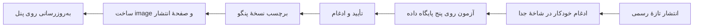

# Pengu panel: a PasarGuard fork

[](https://github.com/Hugsyyyy/pasarguard-panel/releases/latest)
[](https://github.com/Hugsyyyy/pasarguard-panel/actions/workflows/pengu-ci.yml)
[](https://github.com/Hugsyyyy/pasarguard-panel/actions/workflows/test-database-migrations.yml)
[](../LICENSE)
[](https://github.com/PasarGuard/panel)

**A maintained fork of [PasarGuard](https://github.com/PasarGuard/panel)** for the Pengu service.

- Every official release is merged in, with its bug fixes and features.
- It adds a few features of its own, chiefly **My Hosts**: resellers (operators) rename, reorder and hide the panel's servers for their own users only.
- Docker image: `ghcr.io/hugsyyyy/pasarguard-panel:pengu-latest`.
- `pasarguard update` keeps it up to date.
- Licensed under AGPL-3.0, like the original.

The rest of this page is in Persian. Maintenance notes are in [PENGU.md](../PENGU.md).

<div dir="rtl">

## این مخزن چیست

این مخزن **فورک** پنل [PasarGuard](https://github.com/PasarGuard/panel) است و برای سرویس پنگو نگه‌داری می‌شود. خود پنل را تیم پاسارگارد می‌سازد. ما هر نسخهٔ رسمی را برمی‌داریم، چند قابلیت خودمان را رویش می‌گذاریم و همه را دوباره آزمایش می‌کنیم.

- **هر چیزی که در نسخهٔ رسمی هست، این‌جا هم هست.** همان پنل، همان API، همان پایگاه داده‌ها و همان نودها.
- **هر نسخه و هر رفع باگ رسمی** خودکار به این مخزن می‌آید و بعد از گذشتن از آزمون‌ها منتشر می‌شود.
- **تغییرهای ما کوچک و جدا** نگه داشته شده‌اند، تا ادغام نسخه‌های رسمی تمیز بماند.

## چه چیزی اضافه دارد

| | نسخهٔ رسمی | این فورک |
|---|:---:|:---:|
| همهٔ امکانات و رفع باگ‌های رسمی | ✓ | ✓ |
| «هاست‌های من»: اسم، ترتیب و نمایش سرورها برای کاربران هر نماینده | ✗ | ✓ |
| دیدن و پاک کردن تنظیمات «هاست‌های من» هر نماینده توسط مالک | ✗ | ✓ |
| بخش نسخهٔ داشبورد که از انتشارهای همین مخزن خبر می‌دهد | — | ✓ |
| به‌روزرسانی با `pasarguard update` از همین مخزن | — | ✓ |

## هاست‌های من، برای نماینده‌ها

نماینده‌ها (ادمین‌هایی که اجازهٔ ساخت یا ویرایش هاست ندارند) در منوی کنار داشبورد یک صفحهٔ تازه به اسم **هاست‌های من** دارند. هر تغییری آن‌جا بدهند **فقط روی اشتراک کاربران خودشان** اثر می‌گذارد و هاست‌های اصلی پنل و کاربران بقیهٔ نماینده‌ها دست نمی‌خورند.

**نماینده چه کارهایی می‌تواند بکند:**

- **عوض کردن اسم هر سرور**، با همان متغیرهای اسم هاست؛ مثلاً
  `🇩🇪 آلمان {USERNAME}`، `{STATUS_EMOJI} {DATA_LEFT}` یا `{DAYS_LEFT} روز`.
  متغیرهای دیگر: `{DATA_USAGE}`، `{DATA_LIMIT}`، `{TIME_LEFT}`، `{EXPIRE_DATE}`، `{JALALI_EXPIRE_DATE}`.
- **جابه‌جا کردن ترتیب**: با کشیدن و رها کردن، یا دکمه‌های بالا و پایین در موبایل.
- **پنهان کردن سرورهایی** که نمی‌خواهد به کاربرانش برسد.
- **بازنشانی**: اسم یک سرور، ترتیب، یا همه‌چیز را با یک دکمه به حالت پنل برگرداند.

**قاعده‌ها:**

- هر نماینده فقط سرورهای **گروه‌هایی را می‌بیند که نقشش اجازه دارد**.
- تا نماینده ترتیب را دست نزند، کاربرانش **همان ترتیب پنل** را می‌گیرند. چیدمان تصادفی هم اگر روشن باشد می‌ماند، و تغییرهای بعدی مدیر پنل به آن‌ها می‌رسد.
- اگر نماینده ترتیب خودش را بگذارد، **سرورهایی که بعداً به پنل اضافه می‌شوند ته فهرستش** می‌آیند و در صفحه‌اش دیده می‌شوند تا جابه‌جایشان کند.
- سروری که مدیر پنل غیرفعال کرده، برای کاربران هیچ نماینده‌ای نمایش داده نمی‌شود.
- اسم‌ها همان محدودیت‌های اسم هاست اصلی را دارند و ورودی نامعتبر رد می‌شود.

**امنیت:**

- مالک پنل و ادمین‌هایی که اجازهٔ ویرایش هاست دارند این صفحه را ندارند؛ برایشان معنایی ندارد.
- کلیدهای API با مجوز سفارشی، حتی کلید خود مالک، به این قابلیت راه ندارند.
- ادمینی که محدود شده نمی‌تواند تغییری ذخیره کند.
- مالک می‌تواند تنظیمات هر نماینده را ببیند و پاک کند (بخش «API هاست‌های من» در پایین).

## نصب

image این فورک جایگزین image رسمی پنل در همان نصب رسمی پاسارگارد می‌شود. پایگاه داده، نودها و بقیهٔ سرویس‌ها همان‌اند.

**پنل تازه:**

1. پنل را با [اسکریپت نصب رسمی پاسارگارد](https://github.com/PasarGuard/scripts) نصب کنید.
2. قدم‌های «پنل موجود» را انجام دهید.

**پنل موجود** (که الان نسخهٔ رسمی دارد):

1. پشتیبان بگیرید:

   ```sh
   pasarguard backup
   ```

2. در `/opt/pasarguard/docker-compose.yml`، در بخش سرویس `pasarguard`، خط image را عوض کنید:

   ```yaml
   image: ghcr.io/hugsyyyy/pasarguard-panel:pengu-latest
   ```

3. فقط پنل را با image تازه بالا بیاورید (پایگاه داده و بقیه دست نمی‌خورند):

   ```sh
   cd /opt/pasarguard
   docker compose pull pasarguard
   docker compose up -d --no-deps pasarguard
   ```

   مهاجرت‌های پایگاه داده موقع بالا آمدن خودکار اجرا می‌شوند. نسخهٔ پنل در داشبورد باید مثل `5.6.0-pengu.1` دیده شود.

> image فعلاً فقط برای سرورهای `amd64` (x86_64) ساخته می‌شود.

## به‌روزرسانی

بعد از نصب، **`pasarguard update` از همین مخزن به‌روز می‌کند**: آخرین انتشار این فورک (`pengu-latest`) را می‌کشد و پنل را ری‌استارت می‌کند. داشبورد هم وقتی انتشار تازه‌ای بیاید خبر می‌دهد.

- `pasarguard update` همهٔ imageهای `docker-compose.yml` را می‌کشد، از جمله پایگاه داده، و همهٔ سرویس‌ها را دوباره بالا می‌آورد؛ مثل نسخهٔ رسمی.
- اگر فقط خود پنل را می‌خواهید، همان دو دستور قدم ۳ نصب کافی است.
- `pasarguard install` (نصب از نو) image را به نسخهٔ رسمی برمی‌گرداند. بعد از آن خط image را دوباره عوض کنید.

## برگشت به نسخهٔ رسمی

برگشت ممکن است و روی کپی پایگاه دادهٔ واقعی آزموده شده. فقط تنظیمات «هاست‌های من» پاک می‌شوند.

1. پنل را خاموش کنید:

   ```sh
   cd /opt/pasarguard
   docker compose stop pasarguard
   ```

2. با image همین فورک، تغییرهای پایگاه دادهٔ فورک را برگردانید. شناسهٔ آخرین مهاجرت نسخهٔ رسمی را در [PENGU.md](../PENGU.md) ببینید؛ برای `v5.6.0` این است:

   ```sh
   docker compose run --rm --no-deps --entrypoint python pasarguard -m alembic downgrade 1a2b3c4d5e6f
   ```

3. خط image را به نسخهٔ رسمی هم‌پایه برگردانید (مثلاً `pasarguard/panel:v5.6.0`).
4. `docker compose up -d --no-deps pasarguard`

## نسخه‌ها و image

- هر انتشار این مخزن برچسب **`vX.Y.Z-pengu.N`** دارد: نسخهٔ رسمی `vX.Y.Z` به‌اضافهٔ تغییرهای ما. `N` برای انتشارهای بعدی روی همان نسخهٔ رسمی بالا می‌رود.
- برای هر نسخه یک [صفحهٔ انتشار](https://github.com/Hugsyyyy/pasarguard-panel/releases) هست.
- imageها:

  | برچسب | چیست |
  |---|---|
  | `ghcr.io/hugsyyyy/pasarguard-panel:pengu-latest` | همیشه آخرین انتشار؛ برای `pasarguard update` |
  | `ghcr.io/hugsyyyy/pasarguard-panel:vX.Y.Z-pengu.N` | یک نسخهٔ مشخص، برای ثابت نگه داشتن پنل |

## همراه ماندن با نسخهٔ رسمی



- یک workflow هر روز آخرین انتشار رسمی را چک می‌کند.
- اگر انتشار تازه‌ای باشد، آن را در یک شاخهٔ `sync/...` ادغام می‌کند و درخواست ادغام باز می‌کند. همهٔ آزمون‌های رسمی و آزمون‌های ما روی آن اجرا می‌شوند.
- اگر ادغام تداخل داشته باشد، یک issue باز می‌شود تا دستی ادغام شود.
- چیزی خودکار روی پنلی نصب نمی‌شود: هر انتشار فقط بعد از سبز شدن آزمون‌ها و تأیید ساخته می‌شود.

## API «هاست‌های من»

همهٔ API رسمی پاسارگارد مثل قبل است. این مسیرها اضافه شده‌اند:

| مسیر | چه کسی | کار |
|---|---|---|
| `GET /api/hosts/preferences` | نماینده | سرورها همان‌طور که کاربرانش می‌گیرند، به ترتیب خودش |
| `PUT /api/hosts/preferences` | نماینده | ذخیرهٔ اسم‌ها، ترتیب و نمایش؛ هر سرور صفحه باید دقیقاً یک بار فرستاده شود |
| `DELETE /api/hosts/preferences` | نماینده | بازنشانی کامل |
| `GET /api/admin/by-username/{username}/host-preferences` | مالک | دیدن تغییرهای یک ادمین |
| `DELETE /api/admin/by-username/{username}/host-preferences` | مالک | پاک کردن تنظیمات یک ادمین |

نمونهٔ بدنهٔ `PUT`: سرور ۷ با اسم تازه، سرور ۹ پنهان، ترتیب پنل دست‌نخورده (`priority: null` برای همه):

```json
[
  {"id": 7, "remark": "🇩🇪 آلمان {USERNAME}", "priority": null, "enabled": true},
  {"id": 9, "remark": null, "priority": null, "enabled": false},
  {"id": 12, "remark": null, "priority": null, "enabled": true}
]
```

برای ترتیب دلخواه، `priority` را برای همهٔ سرورها جایگاه دلخواه بدهید (۰، ۱، ۲ و ...).

پاسخ‌ها:

- اگر فهرست سرورهای پنل وسط کار عوض شده باشد: `409`.
- اسم نامعتبر: `422`.
- کسی که اجازه ندارد: `403`.

## سازگاری و آزمون‌ها

- **API، پایگاه داده‌ها و نودها** همان نسخهٔ رسمی‌اند. SQLite، PostgreSQL، TimescaleDB، MySQL و MariaDB پشتیبانی می‌شوند.
- **ربات‌ها و ابزارهایی که با API رسمی کار می‌کنند** بدون تغییر کار می‌کنند. مسیرهایی که ربات‌های ما صدا می‌زنند یکی‌یکی مقایسه شده‌اند.
- **کاربرانی که نماینده‌شان «هاست‌های من» را استفاده نکرده** دقیقاً همان اشتراک نسخهٔ رسمی را می‌گیرند. این روی کپی دادهٔ واقعی، در همهٔ قالب‌های اشتراک، مقایسه شده است.
- **پیش از هر انتشار:**
  - همهٔ آزمون‌های رسمی پاسارگارد به‌اضافهٔ آزمون‌های ما روی هر پنج پایگاه داده اجرا می‌شوند.
  - lint و ساخت داشبورد هم چک می‌شوند.
  - شاخهٔ `pengu` محافظت‌شده است و فقط با درخواست ادغام و آزمون‌های سبز عوض می‌شود.

## پرسش‌های رایج

**امکانات تازهٔ نسخه‌های رسمی هم می‌آید؟**
بله. هر انتشار رسمی خودکار ادغام و آزمایش می‌شود و بعد به‌صورت `vX.Y.Z-pengu.N` منتشر می‌شود.

**ربات یا اپ من با این نسخه کار می‌کند؟**
اگر با API رسمی پاسارگارد کار می‌کند، بله. چیزی از API رسمی حذف یا عوض نشده است.

**اگر برگردیم به نسخهٔ رسمی چه می‌شود؟**
همه‌چیز می‌ماند، جز تنظیمات «هاست‌های من». کاربران نماینده‌ها دوباره هاست‌های اصلی پنل را می‌گیرند. بخش «برگشت به نسخهٔ رسمی» را ببینید.

**نماینده می‌تواند کاربران یا هاست‌های بقیه را عوض کند؟**
نه. تنظیماتش فقط روی اشتراک کاربران خودش اثر دارد و هاست‌های اصلی هیچ‌وقت عوض نمی‌شوند.

**چرا این قابلیت در نسخهٔ رسمی نیست؟**
تیم پاسارگارد این درخواست ادغام را نپذیرفت. به همین دلیل در یک فورک جدا با آزمون‌های بیشتر نگه‌داری می‌شود.

## توسعه

- شاخهٔ اصلی `pengu` است. کار تازه روی شاخهٔ `feat/...` یا `fix/...` انجام می‌شود و با درخواست ادغام وارد می‌شود. `main` همان شاخهٔ رسمی است و دست نمی‌خورد.
- آزمون‌ها مثل پروژهٔ اصلی اجرا می‌شوند: `make setup-test` و بعد `make test`.
- قاعدهٔ مهاجرت‌های پایگاه داده، روند همگام‌سازی با نسخهٔ رسمی و جزئیات فنی در [PENGU.md](../PENGU.md) است.
- مستندات خود پنل: [مستندات رسمی پاسارگارد](https://docs.pasarguard.org/fa) و [README اصلی پروژه](../README.md).

## مجوز و سپاس

- این فورک مثل پروژهٔ اصلی تحت مجوز [AGPL-3.0](../LICENSE) است و کد کاملش همین‌جا عمومی است.
- همهٔ اعتبار پنل از آن [تیم PasarGuard](https://github.com/PasarGuard) و مشارکت‌کنندگانش است.
- پایهٔ «هاست‌های من» درخواست ادغام [#1185](https://github.com/PasarGuard/panel/pull/1185) از [AsanFillter](https://github.com/AsanFillter) است. ما آن را بازبینی کردیم، ایرادهایش را رفع کردیم و آزمون‌هایش را کامل کردیم.

</div>
